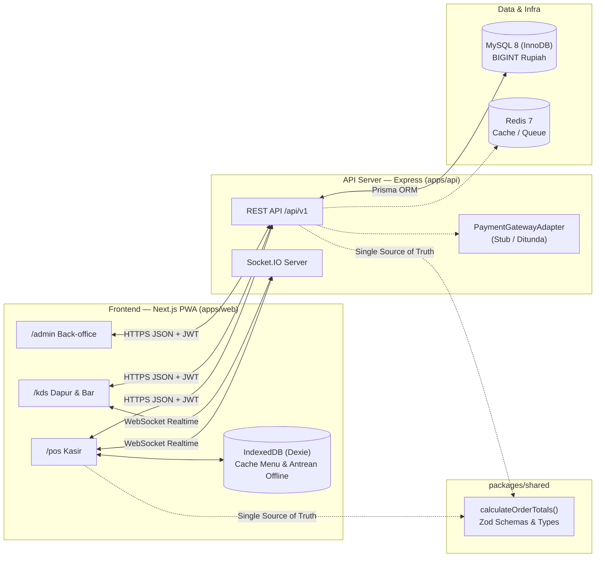
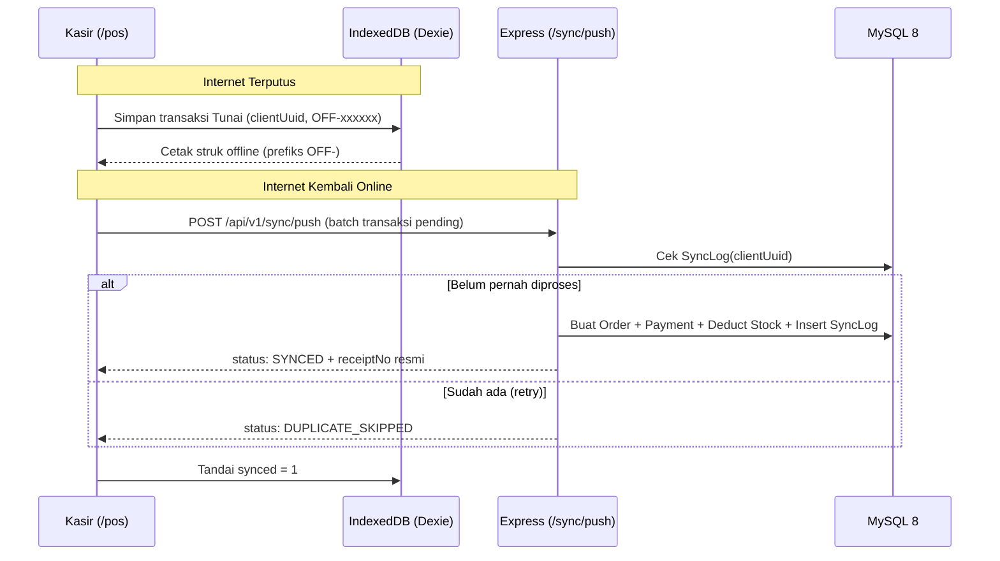

# 02 — System Design & Arsitektur Teknis
**Stack:** Next.js 15 (App Router) + Express + Prisma + MySQL 8 + Socket.IO + Dexie IndexedDB  

---

## 1. Diagram Arsitektur Tingkat Tinggi



---

## 2. Struktur Monorepo (`pnpm workspaces` + Turborepo)
```text
/Users/ahdirmai/Pos/
├── apps/
│   ├── api/                 # Express + TypeScript + Prisma + Socket.IO
│   └── web/                 # Next.js App Router + Cadra UI + Dexie + TanStack Query
├── packages/
│   └── shared/              # Kalkulasi pajak/service/pembulatan/HPP, Zod schemas, Vitest
├── docker/
│   ├── docker-compose.yml   # MySQL 8 (port 3316), Redis 7 (port 6380)
│   └── nginx.conf           # Reverse proxy production
└── Docs/
    ├── 01-PRD.md ... 06-Runbook-and-Deployment.md
    └── prototype/           # Next.js Standalone Prototype (tanpa BE)
```

---

## 3. Alur Kritis

### 3.1 Alur Perhitungan Total (Single Source of Truth)
Semua perhitungan pajak, service charge, diskon, dan pembulatan ditulis **satu kali** di `packages/shared/src/calculations.ts` dan diuji dengan Vitest:
1. `subtotal = Σ ((unitPrice + modifiersPrice) × quantity)`
2. `netSubtotal = subtotal - itemDiscountTotal - orderDiscountAmount`
3. `serviceCharge = round(netSubtotal × 5%)`
4. `taxBase = netSubtotal + serviceCharge` (karena `taxAfterService = true`)
5. `taxAmount (PB1) = round(taxBase × 10%)`
6. `preRounding = netSubtotal + serviceCharge + taxAmount`
7. `grandTotal = round(preRounding / 100) × 100`
8. `roundingAmount = grandTotal - preRounding`

Server selalu menghitung ulang total saat order dibuat/dibayar agar tidak bisa dimanipulasi dari sisi client.

### 3.2 Alur Mode Offline & Idempotency


### 3.3 Realtime KDS & Meja (Socket.IO)
- Channel per outlet: `orders:outlet:1`, `tables:outlet:1`
- Channel per stasiun KDS: `kds:BAR`, `kds:KITCHEN`, `kds:PASTRY`, `kds:ALL`
- Saat kasir menekan **Kirim Dapur**, backend membuat `OrderRound` + `KitchenTicket` per stasiun lalu memancarkan `kds:updated` sehingga layar dapur langsung menampilkan tiket tanpa refresh.

### 3.4 Strategi Payment Gateway (Ditunda)
- Untuk tahap sekarang, metode **QRIS** beroperasi dalam mode **Konfirmasi Manual** (kasir menunjukkan QRIS statis outlet lalu mencatat nomor referensi / konfirmasi).
- Interface `PaymentGatewayAdapter` di `apps/api/src/lib/payment-gateway.ts` dan webhook idempotent `POST /api/v1/webhooks/payment/:provider` tetap tersedia dan siap dihubungkan ke Midtrans/Xendit saat klien siap.

### 3.5 Arsitektur RBAC Dinamis
- Middleware `requireAuth` memverifikasi JWT lalu me-resolve daftar permission user secara langsung dari MySQL melalui `getLiveUserAuth(userId)` (`apps/api/src/lib/rbac-cache.ts`) dengan TTL singkat 30 detik.
- Setiap mutasi di `/api/v1/rbac/roles` atau `/api/v1/rbac/users` memanggil `invalidateRbacCache()` sehingga pencabutan/pemberian izin dan pergantian role langsung efektif pada request berikutnya tanpa memaksa restart atau menunggu JWT kadaluarsa.
- Verifikasi PIN sensitif (`verifyManagerPin`) memeriksa permission `approval.pin` secara dinamis, bukan hardcode nama role.
- **Proteksi & Navigasi Adaptif di Frontend (`apps/web/src/lib/rbac.ts` & `cadra-shell.tsx`):**
  - Seluruh navigasi (Left Dock, Mobile Bottom Bar, Top Tabs, dan `⌘K` Quick Finder) difilter otomatis berdasarkan permission aktif user.
  - Route Guard mencegah akses URL langsung (mis. Kasir mengetik `/admin` atau `/kds` akan langsung dialihkan ke `/pos`), disinkronkan secara live dari `GET /api/v1/auth/me`.
  - Backend menegakkan permission di seluruh domain (`/kds` butuh `kds.view`, `/stock` butuh `stock.view`/`stock.adjust`, `/reports` & `/shifts` history butuh `report.view`, `/orders` mutasi butuh `order.create`, `/rbac` butuh `role.manage`/`user.manage`).
