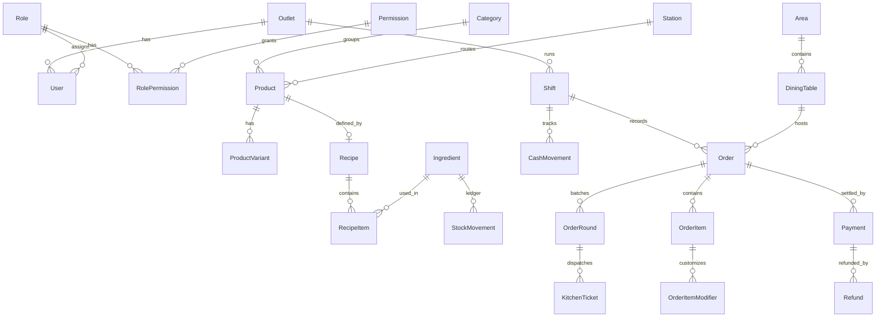

# 04 — Database Schema (MySQL 8 InnoDB)
Sumber kebenaran skema: `apps/api/prisma/schema.prisma`

---

## 1. Konvensi Utama
- **Engine & Charset:** InnoDB, `utf8mb4_unicode_ci`.
- **Uang dalam Rupiah:** Semua kolom nominal menggunakan `BIGINT` (bilangan bulat rupiah, tanpa desimal) untuk menghindari galat floating-point.
- **Single Tenant Multi-Outlet Ready:** Setiap tabel transaksional memiliki kolom `outletId` (default `1`).
- **Offline Idempotency:** `Order.clientUuid CHAR(36) UNIQUE` + tabel `SyncLog(clientUuid UNIQUE)`.
- **Snapshot Harga:** `OrderItem` menyimpan snapshot `productName`, `variantName`, `unitPrice`, `unitCost`, dan `OrderItemModifier` menyimpan snapshot harga modifier saat transaksi.
- **Append-Only Ledger:** `StockMovement` dan `AuditLog` hanya menerima operasi `INSERT`.

---

## 2. Diagram Entitas (ERD Inti)

---

## 3. Indeks Wajib
- `Order`: `@@index([outletId, createdAt])`, `@@index([status])`, `@@index([tableId])`, `clientUuid @unique`, `receiptNo @unique`
- `OrderItem`: `@@index([orderId])`
- `Payment`: `@@index([orderId])`, `@@index([referenceNo])`
- `KitchenTicket`: `@@index([outletId, stationId, status])`, `@@index([orderId])`
- `StockMovement`: `@@index([ingredientId, createdAt])`, `@@index([outletId, createdAt])`
- `AuditLog`: `@@index([outletId, createdAt])`, `@@index([entityType, entityId])`
- `SyncLog`: `clientUuid @unique`
